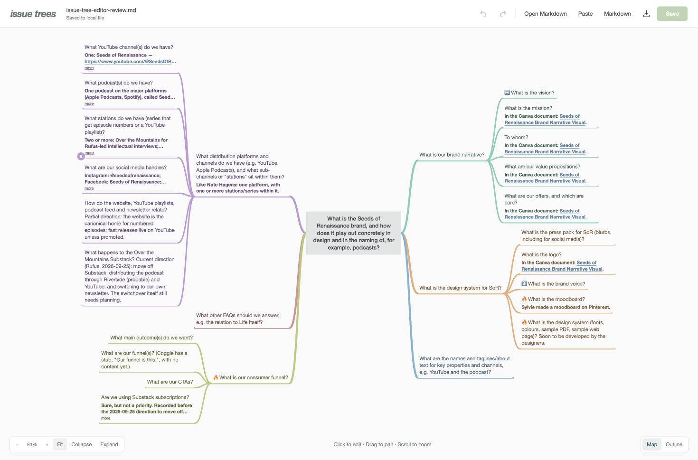

Issue trees now spread into compact, coloured branches on both sides of the central question. Edit questions and answers, add or move branches, undo changes, and explicitly save back to Markdown—with a warning if the source file changed elsewhere.

[Run the local prototype](../tools/viewer/README.md).

