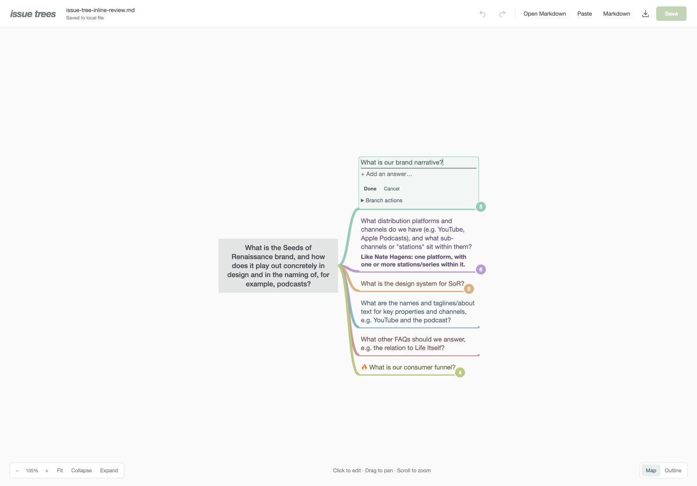

Every branch now flows right, and questions and answers can be edited directly on the tree. Press Enter to finish or Escape to cancel; Save still writes changes explicitly back to Markdown.

[Run the local editor](../tools/viewer/README.md).

