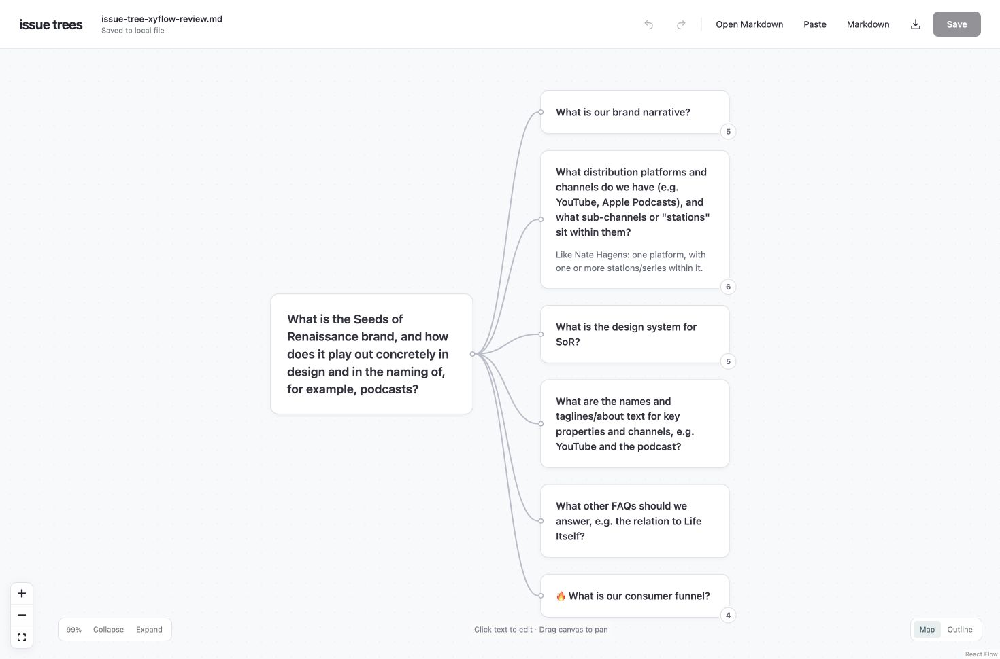
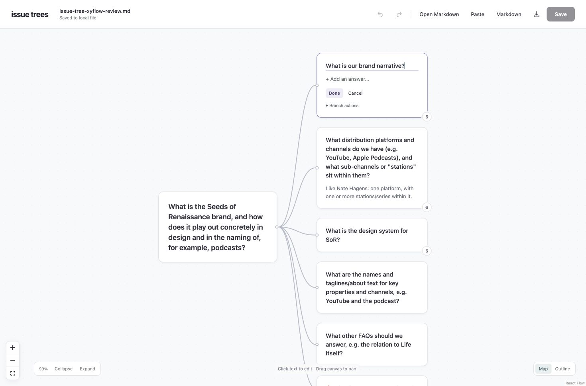

The issue-tree editor now uses React Flow, with padded white nodes, larger text, rounded corners and a quiet dotted canvas. Trees still flow right and text is edited in place, with explicit saves back to Markdown.

[Run the local editor](../tools/viewer/README.md).

